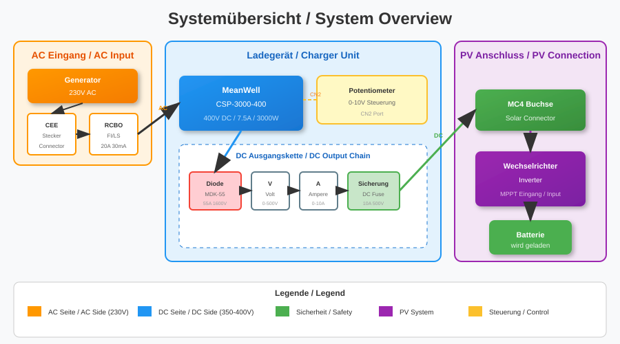
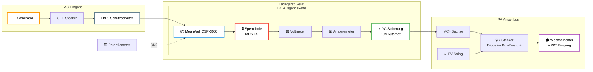
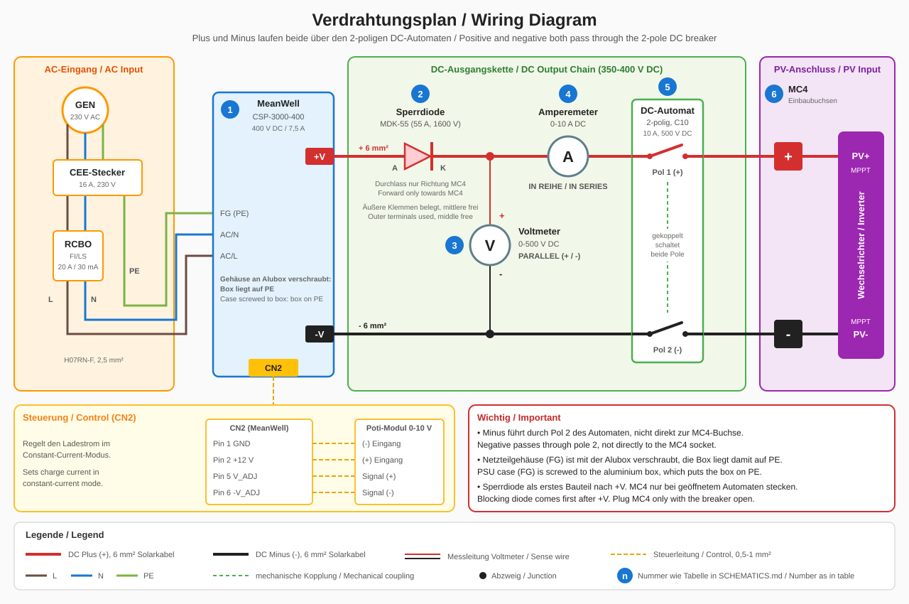
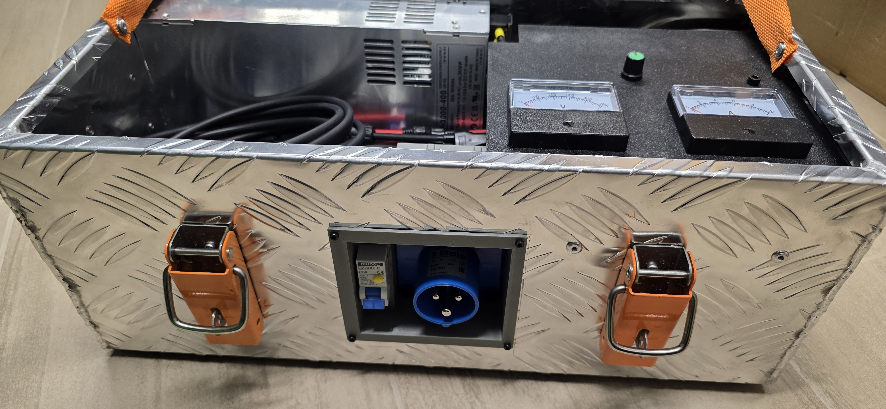
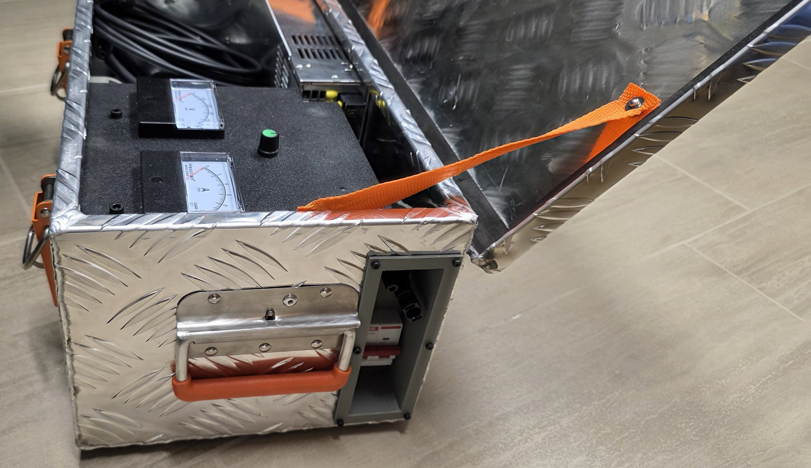
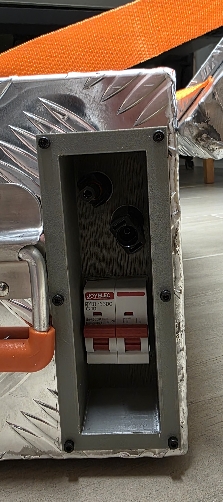

# ⚡ Schaltplan & Anschlüsse / Schematics & Connections

<div align="center">

**Detaillierte Verdrahtung und elektrische Anschlüsse**  
**Detailed Wiring and Electrical Connections**

</div>

---

## 📊 Systemübersicht / System Overview

### Visuelles Blockschaltbild / Visual Block Diagram

<div align="center">



</div>

<details>
<summary>🔍 Mermaid Diagramm anzeigen / Show Mermaid Diagram</summary>



</details>

### Signalfluss / Signal Flow

| Phase | Komponente | Spannung | Beschreibung |
|-------|------------|----------|--------------|
| 1️⃣ | Generator | 230V AC | Stromquelle |
| 2️⃣ | CEE → RCBO | 230V AC | Schutz & Eingang |
| 3️⃣ | MeanWell PSU | AC→DC | Wandlung auf 350-400V DC |
| 4️⃣ | DC Kette | 350-400V DC | Schutz & Monitoring |
| 5️⃣ | MC4 → Y-Stecker → MPPT | 350-400V DC | Ausgang zum Wechselrichter, parallel zum PV-String |

---

## ⚡ Vollständiger Schaltplan / Detailed Wiring

### Visueller Verdrahtungsplan / Visual Wiring Diagram

<div align="center">



</div>

### Reihenfolge der DC-Komponenten (Plus-Pol) / DC Component Order (Positive Rail)

Die korrekte Reihenfolge ist **kritisch** für die Sicherheit! / The correct order is **critical** for safety!

| Nr. | Komponente | Spezifikation | Funktion |
|-----|------------|---------------|----------|
| 1️⃣ | **MeanWell CSP-3000-400 (+V)** | 400V DC, 7.5A | DC-Spannungsquelle |
| 2️⃣ | **Sperrdiode (MDK-55)** | 55A 1600V | 🔴 Verhindert Rückstrom vom PV-System |
| 3️⃣ | **Voltmeter** | 0-500V DC analog | Anzeige der Ausgangsspannung, **parallel** zwischen + und - (nicht in Reihe) |
| 4️⃣ | **Amperemeter** | 0-10A DC analog | Anzeige des Ladestroms, **in Reihe** |
| 5️⃣ | **DC-Automat, Pol 1** | 2-polig, C10, 500V DC | Überlast-/Kurzschlussschutz und Trennung des Plus-Pols |
| 6️⃣ | **MC4 Buchse (+)** | Solar-Standard | Ausgang der Box |
| 7️⃣ | **Y-Stecker mit Diode (+)** | Für max. Stringspannung und Strom ausgelegt | Extern: Diode im Plus-Zweig vor dem Kabel zur Box, führt Box und PV-String zum MPPT-Eingang zusammen |

### Minus-Pol (-V) / Negative Rail

```
MeanWell (-V) ──┬──> DC-Automat, Pol 2 ──> MC4 Buchse (-) ──> Y-Stecker (-, ohne Diode) ──> MPPT (-)
                │
                └──> Voltmeter (-)
```

*Der Minus-Pol läuft über den zweiten Pol des DC-Automaten. So trennt der Automat Plus und Minus gemeinsam vom Wechselrichter.*  
*The negative rail passes through the second pole of the DC breaker, so the breaker disconnects both positive and negative from the inverter.*

### Erdung / Earthing

Das Gehäuse des Netzteils ist mit der Alubox verschraubt und über FG mit PE verbunden. Damit liegt auch die Box auf PE.  
The PSU case is screwed to the aluminium box and connected to PE via FG, which also puts the box on PE.

### Sperrdiode / Blocking Diode

Beim MDK-55 sind die beiden äußeren Klemmen belegt, die mittlere Klemme bleibt frei.  
On the MDK-55 the two outer terminals are used, the middle terminal stays free.

### Verkabelungsspezifikationen / Wiring Specifications

| Leitung | Querschnitt | Typ | Farbe |
|---------|-------------|-----|-------|
| DC Plus (+) | 6mm² | Solarkabel | 🔴 Rot/Red |
| DC Minus (-) | 6mm² | Solarkabel | ⚫ Schwarz/Black |
| Steuerung | 0.5-1mm² | Flexibel | 🟡 Gelb/Yellow |
| AC Eingang | 2.5mm² | H07RN-F | Braun/Blau/Grün-Gelb |

---

## 🎛️ Steuerung (CN2 Port) / Control (CN2 Port)

Die Steuerung erfolgt über ein **0-10V Potentiometer-Modul**, welches an den CN2 Port des MeanWell Netzteils angeschlossen wird.

### MeanWell CN2 Pinbelegung / Pin Assignment

| Pin | Bezeichnung | Funktion | Verbindung |
|-----|-------------|----------|------------|
| **Pin 1** | 12V AUXG (GND) | Masse für Potentiometer | Modul (-) Eingang |
| **Pin 2** | 12V AUX+ (+12V) | Stromversorgung für Potentiometer | Modul (+) Eingang |
| **Pin 5** | V_ADJ | Steuerspannung 0-10V | Modul Signal Ausgang |
| **Pin 6** | -V_ADJ | Signal Masse | Modul Signal (-) |

> ⚠️ **Korrektur / Correction (2026-11-05):** Pin 1 und Pin 2 waren in dieser Doku bisher vertauscht. Wer nach der alten Version verdrahtet hat, sollte die Polarität am Poti-Modul prüfen.
> Pin 1 and Pin 2 were previously swapped in this documentation. If you wired from the old version, check the polarity at the potentiometer module.

> 📏 **Vor dem Anschließen messen / Measure before connecting:** Poti-Modul noch nicht anschließen. Netzteil einschalten und am Kabelende mit dem Multimeter (DC) messen: schwarze Messspitze an Pin 1 (GND), rote an Pin 2 (+12V). Die Anzeige muss ca. **+12V** zeigen. Bei negativem Wert ist die Belegung vertauscht. Erst danach das Modul bei ausgeschaltetem Netzteil anschließen.
> Do not connect the potentiometer module yet. Power on the PSU and measure at the cable end with a multimeter (DC): black probe on pin 1 (GND), red probe on pin 2 (+12V). The reading must be about **+12V**. A negative reading means the wires are swapped. Connect the module only afterwards, with the PSU switched off.

### Schaltschema / Wiring Schematic

```
┌─────────────────┐           ┌──────────────────┐
│   MeanWell      │           │  Potentiometer   │
│   CN2 Port      │           │     Modul        │
│                 │           │                  │
│  Pin 1 (GND)  ──┼───────────┼── (-) Eingang    │
│                 │           │                  │
│  Pin 2 (+12V) ──┼───────────┼── (+) Eingang    │
│                 │           │                  │
│  Pin 5 (V_ADJ)──┼───────────┼── Signal (+)     │
│                 │           │                  │
│  Pin 6 (-V_ADJ)─┼───────────┼── Signal (-)     │
└─────────────────┘           └──────────────────┘
```

> 📷 **Offizielle Dokumentation / Official Documentation:**
> 
> 
> 
> 📄 [MeanWell CSP-3000 Datenblatt / Datasheet (PDF)](https://www.meanwell.com/Upload/PDF/CSP-3000/CSP-3000-SPEC.PDF)

### Spannungseinstellung / Voltage Adjustment

> ⚠️ **Constant Current Mode (CC)**: Das Netzteil ist auf konstanten Strom konfiguriert (CN1).
> Die Spannung variiert je nach Last!

| Poti-Stellung | Steuerspannung | Ohne Last | Mit Last | Ladestrom (ca.) |
|---------------|----------------|-----------|----------|-----------------|
| Minimum | 0V | ~350V DC | - | 0A |
| Mitte | 5V | ~350V DC | ~380V DC | ~4A |
| Maximum | 10V | ~350V DC | ~400V DC | 7.5A |

**Erklärung / Explanation:**
- **Ohne Last (No Load)**: Spannung bleibt bei ~350V (Leerlauf)
- **Mit Last (With Load)**: Spannung steigt auf bis zu 400V (Constant Current Regelung)

---

## ⚠️ Sicherheitshinweise / Safety Notes

<div align="center">

### ⚡ HOCHSPANNUNG - LEBENSGEFAHR / HIGH VOLTAGE - DANGER ⚡

</div>

### Kritische Punkte / Critical Points

| Risiko | Maßnahme | Priorität |
|--------|----------|-----------|
| 🔴 **Sperrdiode** | MUSS als erstes Bauteil nach dem Netzteil sitzen! | ⚠️ KRITISCH |
| 🔴 **Verpolung** | Alle Anschlüsse doppelt prüfen vor Inbetriebnahme | ⚠️ KRITISCH |
| 🔴 **PV-Spannung an der Box** | Parallel zum PV-String nur über Y-Stecker mit Diode anschließen (siehe Hinweis unten) | ⚠️ KRITISCH |
| 🔴 **Rückstrom in den PV-String** | Box nicht laufen lassen, wenn die Stringspannung unter der Box-Spannung liegt (siehe Hinweis unten) | ⚠️ KRITISCH |
| 🟠 **Lichtbogen** | Niemals unter Last stecken/trennen | WICHTIG |
| 🟠 **Kurzschluss** | DC-Automat als Lasttrennschalter verwenden | WICHTIG |
| 🟡 **Wärme** | Sperrdiode benötigt Kühlung (Metallgehäuse) | BEACHTEN |

> ⚠️ **Y-Stecker mit Diode / Y plug with diode:** Parallel zum PV-String wird die Box über einen Y-Stecker mit Diode angeschlossen, die Diode sitzt auf der Plus-Seite vor dem Kabel zur Box. Richtig verdrahtet erreicht die PV-Spannung die Box dann nicht, Voltmeter (0-500V) und DC-Automat (500V DC) sehen nur die maximal 400V des Netzteils. Die 500V-Grenze wird nur relevant, wenn die Diode fehlt, defekt ist oder falsch sitzt und der String über 500V liegen kann (auch Voc bei Kälte). Zeigt das Voltmeter bei ausgeschaltetem Netzteil dauerhaft Spannung, kommt PV-Spannung in die Box: Automat öffnen und die Verdrahtung prüfen. Die Diode im Y-Stecker muss für die maximale Stringspannung ausgelegt sein.
> When connected in parallel with a PV string, the box goes through a Y plug with a diode on the positive side, ahead of the cable to the box. Wired correctly, PV voltage does not reach the box, so the voltmeter (0-500V) and DC breaker (500V DC) only see the PSU's 400V maximum. The 500V limit only matters if the diode is missing, defective or misplaced and the string can exceed 500V (including Voc in cold weather). If the voltmeter keeps showing voltage with the PSU off, PV voltage is entering the box: open the breaker and check the wiring. The diode in the Y plug must be rated for the maximum string voltage.

> ⚠️ **Rückstrom in den PV-String / Reverse current into the PV string:** Die Diode im Box-Zweig schützt nur die Box, der String-Zweig selbst hat keine Diode. Liegt die Stringspannung unter der Box-Spannung (nachts, bei Schatten oder wenigen Modulen), kann Strom von der Box in die Module fließen. Das erwärmt die Module und geht der Ladung verloren. Abhilfe: String während des Betriebs abklemmen oder den String-Zweig ebenfalls mit einer Diode absichern.
> The diode in the box branch only protects the box; the string branch has no diode of its own. If the string voltage is below the box voltage (at night, in shade or with few modules), current can flow from the box into the modules. This heats the modules and is lost for charging. Remedy: disconnect the string during operation, or add a diode to the string branch as well.

### Checkliste vor Inbetriebnahme / Pre-Operation Checklist

- [ ] Alle Schraubverbindungen fest angezogen
- [ ] Kabelquerschnitte entsprechen den Spezifikationen
- [ ] Sperrdiode richtig gepolt (Kathode Richtung MC4)
- [ ] Plus und Minus laufen über je einen Pol des DC-Automaten
- [ ] Durchgang von PE am CEE-Stecker zur Alubox gemessen
- [ ] Keine blanken Leitungen oder Kurzschlussgefahr
- [ ] Parallel zum PV-String nur über Y-Stecker mit Diode angeschlossen (Diode auf der Plus-Seite vor dem Kabel zur Box)
- [ ] Kein Rückstrom in den PV-String möglich (String abgeklemmt oder eigene Diode)
- [ ] RCBO funktioniert (Testknopf drücken)
- [ ] Voltmeter zeigt Spannung erst NACH Einschalten
- [ ] Potentiometer auf Minimum vor dem Start

---

## 📸 Bildergalerie / Photo Gallery

<details>
<summary>🖼️ Interne Verdrahtung anzeigen / Show Internal Wiring</summary>

| Beschreibung | Bild |
|--------------|------|
| Gesamtaufbau |  |
| DC-Verkabelung |  |
| Steuereinheit |  |

</details>

---

**[◀ Zurück zur Aufbauanleitung / Back to Assembly](ASSEMBLY.md)** | **[🏠 Zurück zur Hauptseite / Back to Main](../README.md)**
