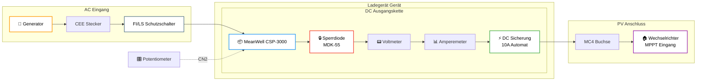

# ⚡ Schaltplan & Anschlüsse / Schematics & Connections

<div align="center">

**Detaillierte Verdrahtung und elektrische Anschlüsse**  
**Detailed Wiring and Electrical Connections**

</div>

---

## 📊 Systemübersicht / System Overview

### Visuelles Blockschaltbild / Visual Block Diagram

<div align="center">


</div>

<details>
<summary>🔍 Mermaid Diagramm anzeigen / Show Mermaid Diagram</summary>



</details>

### Signalfluss / Signal Flow

| Phase | Komponente | Spannung | Beschreibung |
|-------|------------|----------|--------------|
| 1️⃣ | Generator | 230V AC | Stromquelle |
| 2️⃣ | CEE → RCBO | 230V AC | Schutz & Eingang |
| 3️⃣ | MeanWell PSU | AC→DC | Wandlung auf 350-400V DC |
| 4️⃣ | DC Kette | 350-400V DC | Schutz & Monitoring |
| 5️⃣ | MC4 → MPPT | 350-400V DC | Ausgang zum Wechselrichter |

---

## ⚡ Vollständiger Schaltplan / Detailed Wiring

### Visueller Verdrahtungsplan / Visual Wiring Diagram

<div align="center">


</div>

### Reihenfolge der DC-Komponenten (Plus-Pol) / DC Component Order (Positive Rail)

Die korrekte Reihenfolge ist **kritisch** für die Sicherheit! / The correct order is **critical** for safety!

| Nr. | Komponente | Spezifikation | Funktion |
|-----|------------|---------------|----------|
| 1️⃣ | **MeanWell CSP-3000-400 (+V)** | 400V DC, 7.5A | DC-Spannungsquelle |
| 2️⃣ | **Sperrdiode (MDK-55)** | 55A 1600V | 🔴 Verhindert Rückstrom vom PV-System |
| 3️⃣ | **Voltmeter** | 0-500V DC analog | Anzeige der Ausgangsspannung, **parallel** zwischen + und - (nicht in Reihe) |
| 4️⃣ | **Amperemeter** | 0-10A DC analog | Anzeige des Ladestroms, **in Reihe** |
| 5️⃣ | **DC-Automat, Pol 1** | 2-polig, C10, 500V DC | Überlast-/Kurzschlussschutz und Trennung des Plus-Pols |
| 6️⃣ | **MC4 Buchse (+)** | Solar-Standard | Ausgang zum Wechselrichter |

### Minus-Pol (-V) / Negative Rail

```
MeanWell (-V) ──┬──> DC-Automat, Pol 2 ──> MC4 Buchse (-)
                │
                └──> Voltmeter (-)
```

*Der Minus-Pol läuft über den zweiten Pol des DC-Automaten. So trennt der Automat Plus und Minus gemeinsam vom Wechselrichter.*  
*The negative rail passes through the second pole of the DC breaker, so the breaker disconnects both positive and negative from the inverter.*

### Erdung / Earthing

Das Gehäuse des Netzteils ist mit der Alubox verschraubt und über FG mit PE verbunden. Damit liegt auch die Box auf PE.  
The PSU case is screwed to the aluminium box and connected to PE via FG, which also puts the box on PE.

### Sperrdiode / Blocking Diode

Beim MDK-55 sind die beiden äußeren Klemmen belegt, die mittlere Klemme bleibt frei.  
On the MDK-55 the two outer terminals are used, the middle terminal stays free.

### Verkabelungsspezifikationen / Wiring Specifications

| Leitung | Querschnitt | Typ | Farbe |
|---------|-------------|-----|-------|
| DC Plus (+) | 6mm² | Solarkabel | 🔴 Rot/Red |
| DC Minus (-) | 6mm² | Solarkabel | ⚫ Schwarz/Black |
| Steuerung | 0.5-1mm² | Flexibel | 🟡 Gelb/Yellow |
| AC Eingang | 2.5mm² | H07RN-F | Braun/Blau/Grün-Gelb |

---

## 🎛️ Steuerung (CN2 Port) / Control (CN2 Port)

Die Steuerung erfolgt über ein **0-10V Potentiometer-Modul**, welches an den CN2 Port des MeanWell Netzteils angeschlossen wird.

### MeanWell CN2 Pinbelegung / Pin Assignment

| Pin | Bezeichnung | Funktion | Verbindung |
|-----|-------------|----------|------------|
| **Pin 1** | 12V AUXG (GND) | Masse für Potentiometer | Modul (-) Eingang |
| **Pin 2** | 12V AUX+ (+12V) | Stromversorgung für Potentiometer | Modul (+) Eingang |
| **Pin 5** | V_ADJ | Steuerspannung 0-10V | Modul Signal Ausgang |
| **Pin 6** | -V_ADJ | Signal Masse | Modul Signal (-) |

> ⚠️ **Korrektur / Correction (2026-11-05):** Pin 1 und Pin 2 waren in dieser Doku bisher vertauscht. Wer nach der alten Version verdrahtet hat, sollte die Polarität am Poti-Modul prüfen.
> Pin 1 and Pin 2 were previously swapped in this documentation. If you wired from the old version, check the polarity at the potentiometer module.

### Schaltschema / Wiring Schematic

```
┌─────────────────┐           ┌──────────────────┐
│   MeanWell      │           │  Potentiometer   │
│   CN2 Port      │           │     Modul        │
│                 │           │                  │
│  Pin 1 (GND)  ──┼───────────┼── (-) Eingang    │
│                 │           │                  │
│  Pin 2 (+12V) ──┼───────────┼── (+) Eingang    │
│                 │           │                  │
│  Pin 5 (V_ADJ)──┼───────────┼── Signal (+)     │
│                 │           │                  │
│  Pin 6 (-V_ADJ)─┼───────────┼── Signal (-)     │
└─────────────────┘           └──────────────────┘
```

> 📷 **Offizielle Dokumentation / Official Documentation:**
> 
> 
> 
> 📄 [MeanWell CSP-3000 Datenblatt / Datasheet (PDF)](https://www.meanwell.com/Upload/PDF/CSP-3000/CSP-3000-SPEC.PDF)

### Spannungseinstellung / Voltage Adjustment

> ⚠️ **Constant Current Mode (CC)**: Das Netzteil ist auf konstanten Strom konfiguriert (CN1).
> Die Spannung variiert je nach Last!

| Poti-Stellung | Steuerspannung | Ohne Last | Mit Last | Ladestrom (ca.) |
|---------------|----------------|-----------|----------|-----------------|
| Minimum | 0V | ~350V DC | - | 0A |
| Mitte | 5V | ~350V DC | ~380V DC | ~4A |
| Maximum | 10V | ~350V DC | ~400V DC | 7.5A |

**Erklärung / Explanation:**
- **Ohne Last (No Load)**: Spannung bleibt bei ~350V (Leerlauf)
- **Mit Last (With Load)**: Spannung steigt auf bis zu 400V (Constant Current Regelung)

---

## ⚠️ Sicherheitshinweise / Safety Notes

<div align="center">

### ⚡ HOCHSPANNUNG - LEBENSGEFAHR / HIGH VOLTAGE - DANGER ⚡

</div>

### Kritische Punkte / Critical Points

| Risiko | Maßnahme | Priorität |
|--------|----------|-----------|
| 🔴 **Sperrdiode** | MUSS als erstes Bauteil nach dem Netzteil sitzen! | ⚠️ KRITISCH |
| 🔴 **Verpolung** | Alle Anschlüsse doppelt prüfen vor Inbetriebnahme | ⚠️ KRITISCH |
| 🟠 **Lichtbogen** | Niemals unter Last stecken/trennen | WICHTIG |
| 🟠 **Kurzschluss** | DC-Automat als Lasttrennschalter verwenden | WICHTIG |
| 🟡 **Wärme** | Sperrdiode benötigt Kühlung (Metallgehäuse) | BEACHTEN |

### Checkliste vor Inbetriebnahme / Pre-Operation Checklist

- [ ] Alle Schraubverbindungen fest angezogen
- [ ] Kabelquerschnitte entsprechen den Spezifikationen
- [ ] Sperrdiode richtig gepolt (Kathode Richtung MC4)
- [ ] Plus und Minus laufen über je einen Pol des DC-Automaten
- [ ] Durchgang von PE am CEE-Stecker zur Alubox gemessen
- [ ] Keine blanken Leitungen oder Kurzschlussgefahr
- [ ] RCBO funktioniert (Testknopf drücken)
- [ ] Voltmeter zeigt Spannung erst NACH Einschalten
- [ ] Potentiometer auf Minimum vor dem Start

---

## 📸 Bildergalerie / Photo Gallery

<details>
<summary>🖼️ Interne Verdrahtung anzeigen / Show Internal Wiring</summary>

| Beschreibung | Bild |
|--------------|------|
| Gesamtaufbau |  |
| DC-Verkabelung |  |
| Steuereinheit |  |

</details>

---

**[◀ Zurück zur Aufbauanleitung / Back to Assembly](ASSEMBLY.md)** | **[🏠 Zurück zur Hauptseite / Back to Main](../README.md)**
